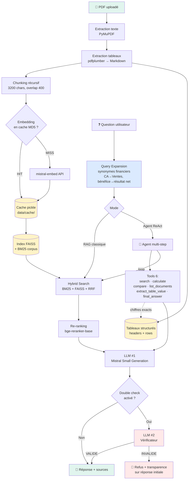

<div align="center">

# 📄 DocSense

### Agent IA d'analyse documentaire — Comprendre vos PDF métier en une question

[](https://www.python.org/)
[](https://mistral.ai/)
[](https://github.com/facebookresearch/faiss)
[](https://streamlit.io/)
[](LICENSE)
[](#-changelog-v3)

**Posez une question en langage naturel sur vos documents financiers ou techniques. Obtenez une réponse précise, sourcée, et auditable.**

[Fonctionnalités](#-fonctionnalités) • [Architecture](#️-architecture) • [Évaluation V3](#-évaluation-chiffrée) • [Choix techniques](#-choix-techniques-justifiés) • [Changelog V3](#-changelog-v3)

</div>

<!-- Capture principale à ajouter dans docs/screenshots/overview.png -->


---

## 🎯 Le problème résolu

Dans les cabinets comptables, d'audit et de conseil, les équipes passent **des heures à fouiller des PDF de centaines de pages** : rapports annuels, documents d'enregistrement universel, notices réglementaires, manuels techniques. Les solutions classiques (Ctrl+F, sommaires PDF) atteignent vite leurs limites face à des documents structurés et volumineux.

**DocSense est un agent IA d'analyse documentaire** qui ingère ces PDF, comprend leur structure (texte + tableaux financiers), et permet de poser des questions en langage naturel. Réponses précises, **citations systématiques des pages sources**, et refus explicite quand l'information n'est pas dans le document — un critère essentiel en environnement réglementaire.

Le système est entièrement local et basé sur l'écosystème européen (**Mistral AI**), ce qui le rend compatible avec les contraintes RGPD et de souveraineté des données — exigence forte dans le secteur financier et juridique français.

---

## ✨ Fonctionnalités

### 🔍 Recherche hybride avancée
- **BM25 (lexical)** + **FAISS (sémantique)** + **Reciprocal Rank Fusion** pour un retrieval robuste
- **Re-ranking cross-encoder** (BAAI/bge-reranker-base) sur les top candidats
- **Support multi-document** avec filtrage par source pour analyser un corpus entier

### 📊 Compréhension des tableaux financiers
- Extraction structurée des tableaux via **pdfplumber** (analyse géométrique)
- Conversion en Markdown préservant les correspondances ligne / colonne
- L'agent identifie précisément la bonne cellule lors d'une question chiffrée

### 🤖 Agent IA autonome (pattern ReAct)
- Décomposition multi-étapes d'une question complexe
- **6 outils** : `search`, `calculate`, `compare_values`, `list_documents`, `extract_table_value`, `final_answer`
- **Trace de raisonnement visible** dans l'UI (THOUGHT / ACTION / OBSERVATION) — critique pour l'auditabilité

<!-- Capture de la trace agent à ajouter dans docs/screenshots/agent_trace.png -->


### 📋 Analyses métier pré-construites
Un clic = une analyse structurée prête à coller dans un livrable :
- **📊 Chiffres clés** (CA, résultat, dette, effectifs)
- **⚠️ Risques & alertes** (catégorisés : marché, opérationnel, financier, géopolitique, ESG)
- **🎯 Stratégie & objectifs** (axes, objectifs chiffrés, projets)
- **📈 Évolution N vs N-1** (tableau comparatif avec calculs de variations)
- **✍️ Note de synthèse exécutive** (1 page pour un manager)

<!-- Capture d'une analyse métier à ajouter dans docs/screenshots/analyse_evolution.png -->


### 🛡️ Anti-hallucination explicite
- Prompts système stricts : refus de répondre si l'info n'est pas dans le contexte
- Citations systématiques des pages sources
- Validation empirique via évaluation chiffrée (cf. section dédiée)

### 📊 Évaluation chiffrée intégrée
- Framework d'évaluation maison inspiré de **RAGAS**
- **5 métriques** : Faithfulness, Answer Relevancy, Context Precision, Context Recall, **Refusal Quality** (custom V3)
- Golden dataset de 12 questions de référence couvrant 7 catégories

---

### ⚡ Cache embeddings persistant (V3.1)
- Hash MD5 de chaque chunk → cache pickle local
- Réindexation d'un PDF déjà vu : **<1 seconde, 0 appel API Mistral**
- Économies significatives sur le quota free tier en phase de dev/test

### 🌊 Streaming des réponses (V3.2)
- Mode RAG classique : réponse token par token (Server-Sent Events)
- Premier mot affiché en **<1 seconde** au lieu d'attendre 5s+
- Expérience utilisateur niveau ChatGPT, en Python pur via `st.write_stream`

### 🔍 Query Expansion automatique (V3.2.5)
- Détection des termes financiers dans la question (CA, bénéfice, dette, etc.)
- Injection automatique des synonymes équivalents avant retrieval + re-ranking
- Résout le bug "chiffre d'affaires" vs "Ventes" : le re-ranker reconnaît maintenant l'équivalence sémantique métier
- Standard pro utilisé par Perplexity et autres RAG de production

### 📐 Outil agent `extract_table_value` (V3.3)
- L'agent ReAct pioche directement dans les tableaux structurés pdfplumber
- Matching intelligent : tolérance accents/casse + synonymes financiers (CA → Ventes)
- Élimine la confusion entre valeurs exactes (15 174 M€) et arrondis communiqués (15,2 Md€)
- Sur question test : agent passe de 7 étapes à 4, avec chiffre exact

### 🛡️ Double check anti-hallucination (V3.5)
- Optionnel via toggle UI (trade-off latence x2)
- Un 2ème LLM (mode "verificateur") relit chaque réponse contre le contexte
- Détecte les affirmations factuelles inventées et remplace par un refus honnête
- Transparence préservée : la réponse initiale est consultable dans l'UI
- Pattern **reflection** standard chez Anthropic et OpenAI

### 📊 Évaluation enrichie : 5ème métrique `refusal_quality` (V3.6)
- Évalue la qualité des refus sur les questions impossibles
- 3 critères pondérés : refus explicite, absence de fabrication, cohérence
- Corrige le défaut connu des 4 métriques RAGAS classiques (qui sortent 0.0 sur les refus)
- Score parfait (1.00) sur les 2 questions hard du golden dataset

### 🧰 Qualité de code (V3.4 + V3.7)
- **Logging structuré** : module `logging` standard Python, niveaux DEBUG/INFO/WARN/ERROR, configurable via `LOG_LEVEL` env
- **Suite pytest** : 26 tests automatisés sur les modules critiques (parsing, calculs, query expansion, table query)
- Tests rapides (<5s) sans appel LLM, lancés en 1 commande : `pytest`

---

## 🏗️ Architecture



### Pipeline en bref

**Indexation** (une fois par document) :
- Extraction du texte (PyMuPDF) et des tableaux structurés (pdfplumber → Markdown ET structures Python séparées)
- Chunking récursif respectant la hiérarchie paragraphe / phrase / mot (3200 caractères avec overlap 400)
- Embeddings via **wrapper custom Mistral** avec **cache MD5 persistant** : chaque chunk est hashé, et un PDF déjà vu est ré-embed en <1 seconde et 0 appel API
- Index FAISS local + corpus BM25 en mémoire + index des tableaux structurés exploitable par l'agent

**Recherche RAG classique** (à chaque question) :
1. **Query Expansion** : détection automatique des termes financiers (CA, bénéfice, dette...) et injection de leurs synonymes entre parenthèses
2. Recherche **hybride** (BM25 lexical + FAISS sémantique) fusionnée par Reciprocal Rank Fusion (k=60)
3. **Re-ranking** cross-encoder (BAAI/bge-reranker-base) pour affiner le top-K
4. Génération **streamée** par Mistral Small (Server-Sent Events) avec prompt strict anti-hallucination + table de synonymes métier intégrée
5. Citation systématique des pages sources
6. **Double check optionnel** : un 2ème LLM relit la réponse et invalide si une affirmation factuelle n'est pas supportée par le contexte

**Mode Agent ReAct (optionnel)** :
- Le LLM produit `THOUGHT` + `ACTION` à chaque étape
- 6 outils disponibles : `search`, `calculate`, `compare_values`, `list_documents`, **`extract_table_value`** (chiffres exacts depuis tableaux structurés), `final_answer`
- L'agent privilégie `extract_table_value` sur les chiffres précis (évite la confusion entre "86,2 Md€" arrondi et "86 153 M€" exact)
- Boucle sur les `OBSERVATION` jusqu'à convergence
- **Trace complète exposée dans l'UI** pour audit (THOUGHT / ACTION / OBSERVATION par étape)

---

## 🛠️ Stack technique

| Composant | Technologie | Version | Justification |
|---|---|---|---|
| **LLM (génération)** | Mistral Small (`mistral-small-latest`) | API | Acteur européen, gratuit (plan Experiment), RGPD-friendly |
| **Embeddings** | Mistral Embed | 1024d | Cohérence stack, gratuit, qualité comparable à OpenAI |
| **Vector store** | FAISS | 1.9.0 | Local, gratuit, rapide, contrôle total des données |
| **Retrieval lexical** | rank-bm25 | 0.2.2 | Standard industrie pour BM25, léger |
| **Re-ranker** | BAAI/bge-reranker-base | 280 Mo | Multi-langue (FR), CPU-only, état de l'art open-source |
| **PDF (texte)** | PyMuPDF | 1.24.10 | Rapidité, extraction de texte fluide |
| **PDF (tableaux)** | pdfplumber | 0.11.4 | Analyse géométrique, structure ligne/colonne préservée |
| **Orchestration** | LangChain | 0.3.7 | Documents, splitters, intégrations standards |
| **UI** | Streamlit | 1.40.1 | POC IA visuel en Python pur, déploiement gratuit |
| **Évaluation** | RAGAS-inspired (custom) | maison | 5 métriques LLM-as-judge, sans dépendance lib tierce |
| **Tests** | pytest | 8.3.4 | Standard industrie, 26 tests automatisés |

---

## 🧠 Choix techniques justifiés

Cette section explique les décisions importantes du projet et leurs alternatives. C'est ce qui distingue un projet *qui marche* d'un projet *que je peux défendre*.

### 1. Pourquoi Mistral plutôt qu'OpenAI ?

**Décision** : utiliser Mistral comme LLM et fournisseur d'embeddings.

**Raisons** :
- 🇪🇺 **Souveraineté européenne** : serveurs basés à Paris, juridiction française, conformité RGPD native — argument décisif pour cabinets comptables, juridiques, ou clients secteurs sensibles
- 💸 **Plan gratuit accessible** : aucune carte bancaire requise, idéal pour un projet portfolio
- 🚀 **Qualité comparable** : Mistral Small bat GPT-3.5 sur la plupart des benchmarks RAG en français
- 🔄 **Architecture agnostique** : le pipeline pourrait basculer vers OpenAI ou Claude en changeant uniquement `src/embeddings.py` et `src/generation.py`

**Limite** : le plan Experiment a des rate limits stricts (gérés via retry exponentiel dans le code).

### 2. Pourquoi Hybrid Search (BM25 + FAISS) plutôt que sémantique seul ?

**Décision** : combiner BM25 (lexical) et FAISS (sémantique) via Reciprocal Rank Fusion.

**Raisons** :
- 🎯 **BM25 verrouille les références exactes** : noms propres (Tiffany, Sephora), codes (IFRS 16, MiFID II), chiffres précis — là où l'embedding sémantique peut confondre
- 🧠 **Le sémantique gère les paraphrases** : "bénéfice net" ↔ "résultat net", "CA" ↔ "ventes"
- 🔀 **RRF (k=60)** : standard littérature, sans tuning d'hyperparamètres fragile

**Validation empirique** : la question *"chiffres IFRS 16"* atteint une faithfulness de **1.00** dans l'évaluation — preuve directe que BM25 ancre les références exactes.

### 3. Pourquoi un wrapper custom autour de Mistral plutôt que `langchain-mistralai` ?

**Décision** : implémenter `MistralEmbeddings` à la main qui appelle directement le SDK officiel `mistralai`.

**Raisons** :
- 🐛 **Bug d'incompatibilité** identifié dans `langchain-mistralai` (KeyError `'data'`) avec l'API actuelle
- 🔧 **Gestion fine du rate limit** : retry exponentiel custom (2s, 4s, 8s, 16s, 32s) adapté au plan gratuit
- ✅ **Compatibilité préservée** : le wrapper respecte l'interface `Embeddings` de LangChain — FAISS, retrievers et chains fonctionnent sans modification

Cette décision illustre une réalité du métier : les libs IA évoluent vite et ont des bugs ; savoir contourner avec un wrapper minimal est une compétence d'ingénieur.

### 4. Pourquoi le pattern ReAct pour l'agent ?

**Décision** : implémenter le pattern ReAct (Yao et al. 2022) plutôt qu'utiliser `LangChain Agents` clé-en-main.

**Raisons** :
- 🔬 **Compréhension complète** : chaque ligne de la boucle d'orchestration est documentée et maîtrisée
- 🎛️ **Contrôle des modes de défaillance** : max_iterations, sortie au format invalide, hallucinations d'outils inconnus, calls mal formés, troncature contexte
- 👁️ **Trace transparente** : THOUGHT / ACTION / OBSERVATION visibles dans l'UI = auditabilité native (critère essentiel en audit / conformité)
- 🔌 **Indépendance vis-à-vis des updates LangChain** : pas de cassure quand la lib change d'API

### 5. Pourquoi un framework d'évaluation custom (et pas RAGAS direct) ?

**Décision** : implémenter les métriques RAGAS à la main avec Mistral comme juge.

**Raisons** :
- 🎓 **Compréhension du fonctionnement** : chaque métrique est codée en transparent, on comprend exactement ce qu'on mesure
- 🇪🇺 **Cohérence stack** : tout en Mistral, pas de dépendance OpenAI obligée par RAGAS
- 🛠️ **Personnalisation des prompts d'évaluation** : on peut ajuster la sévérité du juge selon le cas d'usage
- 📦 **Zéro dépendance supplémentaire** : 5 fichiers Python suffisent
- ➕ **Extensibilité** : a permis d'ajouter la métrique custom `refusal_quality` en V3.6 (impossible avec RAGAS officiel)

**Limite assumée** : utiliser le même LLM (Mistral) comme générateur et juge introduit un biais d'auto-évaluation. C'est documenté dans la section *Limites connues*.

### 6. Pourquoi FAISS local plutôt que Pinecone / Weaviate / Qdrant ?

**Décision** : index FAISS local, persisté sur disque.

**Raisons** :
- 💰 **Coût zéro** vs solutions SaaS payantes
- 🔒 **Données locales** : aucune sortie vers un service tiers — critique en RGPD strict
- ⚡ **Performance suffisante** à l'échelle d'un projet : sur quelques milliers de chunks, FAISS plat est instantané
- 📈 **Migration possible** : si le corpus grossit à 1M+ chunks, migration vers Qdrant ou pgvector en remplaçant `src/vectorstore.py`

### 7. Pourquoi le re-ranking est-il un toggle (et pas activé par défaut systématiquement) ?

**Décision** : exposer le re-ranking dans l'UI sous forme de toggle activable.

**Raisons** :
- 🔬 **Observation empirique** : sur des corpus petits (<50 chunks), le re-ranking n'apporte pas de gain net car le hybrid retrieval est déjà très bon
- ⚖️ **Trade-off latence** : le re-ranker ajoute ~1-2s par question
- 📊 **Bénéfice à grande échelle** : sur 1000+ chunks, le re-ranking devient discriminant

C'est une décision **data-driven** plutôt qu'idéologique : on a mesuré, on a constaté, on a documenté.

### 8. Pourquoi un cache MD5 fait main plutôt que les caches officiels LangChain ?

**Le problème** : ré-indexer un PDF déjà vu = appels API Mistral inutiles + temps perdu + quota free tier consommé.

**L'option naïve** : utiliser `langchain.cache` ou `CacheBackedEmbeddings` de LangChain. C'est documenté, c'est officiel.

**Pourquoi pas** :
- Couche d'abstraction supplémentaire qui complique le debug (déjà que `langchain-mistralai` a un bug `KeyError 'data'` qui m'a forcé à écrire un wrapper custom — voir choix #3)
- Dépendance à une API qui peut changer entre versions
- Pour un cache de strings → embeddings, un simple `dict[hash → vector]` persisté en pickle suffit

**Notre choix** : **wrapper custom autour de mon `MistralEmbeddingsWrapper`**, avec hash MD5 de chaque chunk comme clé, fichier pickle dans `data/cache/embeddings_cache.pkl`.

**Code minimaliste** :
```python
def _compute_hash(text):
    return hashlib.md5(text.encode("utf-8")).hexdigest()

# Au runtime : cache hit/miss + stats
n_hits = 0
for text in texts:
    h = self._compute_hash(text)
    if h in self._cache:
        n_hits += 1
        # ... récupère vecteur depuis cache ...
    else:
        # ... appelle API + persiste ...
```

**Résultat** : un PDF déjà indexé est ré-embed en **<1 seconde, 0 appel API**, et le code fait **40 lignes**.

**Trade-off assumé** :
- Le cache n'invalide pas si je change de modèle d'embeddings → si je migre vers BGE-M3, je dois supprimer `data/cache/` manuellement (acceptable : c'est explicite, pas un bug silencieux)
- Pas de TTL → le cache grossit indéfiniment, mais MD5 + vecteur 1024d = ~8 KB par chunk, négligeable

### 9. Pourquoi query expansion plutôt que fine-tuner le re-ranker sur du vocabulaire financier ?

**Le problème** : le re-ranker `bge-reranker-base` est **entraîné sur du texte anglais générique**. Il ne sait pas que "CA" = "chiffre d'affaires" = "Ventes" = "revenus" en compta française. Conséquence : sur la question *"Quel est le chiffre d'affaires en 2023 ?"*, le re-ranker **rétrogradait** le tableau "Ventes 2023 : 86 153" hors du top-K, et le LLM finissait par refuser de répondre alors que l'info était indexée.

**L'option lourde** : fine-tuner le re-ranker sur un corpus financier français annoté (paires (query, document) avec scores de pertinence).

**Pourquoi pas** :
- Demande un dataset annoté de 5000+ paires minimum (semaines de boulot)
- Coût compute non négligeable (même un fine-tuning léger demande quelques heures sur GPU)
- Sortie : un modèle figé, à ré-entraîner à chaque évolution du vocabulaire métier
- **Pas adapté à un sprint solo en 2 jours**

**Notre choix** : **query expansion explicite en amont**. Un module `src/query_expansion.py` de ~80 lignes qui détecte les termes financiers dans la question (regex avec word boundaries) et **injecte les synonymes équivalents entre parenthèses** avant le retrieval ET le re-ranking.

```python
FINANCIAL_SYNONYMS = {
    "chiffre d'affaires": ["ventes", "revenus", "CA"],
    "bénéfice": ["résultat net", "profit"],
    "dette": ["endettement", "passif financier"],
    # ...
}

# Question utilisateur :
# "Quel est le chiffre d'affaires en 2023 ?"
#
# Question expandée envoyée au retrieval + re-ranker :
# "Quel est le chiffre d'affaires (ventes, revenus, CA) en 2023 ?"
```

**Résultat** : le re-ranker voit maintenant les mots "ventes" et "revenus" dans la query, et il rapproche logiquement le tableau "Ventes 2023 : 86 153". **Plus de "info non disponible" sur du vocabulaire métier.**

**Trade-off assumé** :
- Le dictionnaire de synonymes est figé et maintenu à la main → 100% lisible, mais à enrichir au cas par cas
- Marche bien pour le **vocabulaire stable** (compta IFRS, finance d'entreprise) ; moins bien pour des termes très nichés (assurance vie, instruments dérivés exotiques)
- C'est exactement comme ça que **Perplexity et autres RAG de prod commerciaux** gèrent les synonymes métier — la query expansion explicite est devenue un standard pratique

### 10. Pourquoi un 2ème LLM verificateur plutôt que durcir encore le prompt anti-hallucination ?

**Le problème** : à l'évaluation V2.7, sur la question *"Quel est le nom du PDG de LVMH ?"*, mon RAG répondait *"Bernard Arnault"* alors que ce nom **n'était pas dans les chunks remontés**. Mistral le connaissait par son pré-entraînement et le sortait, malgré mon prompt anti-hallucination strict.

**L'option naïve** : durcir encore le prompt. Ajouter *"INTERDICTION ABSOLUE de répondre si l'info n'est pas dans le contexte"*, en MAJUSCULES, 3 fois.

**Pourquoi pas** :
- Un prompt strict ne **détecte pas une hallucination** : il l'**implore d'éviter**. Tant que le LLM décide librement de répondre, il peut violer le prompt
- Les benchmarks récents montrent que les LLMs (même GPT-4 et Claude) hallucinent **5 à 15%** sur des questions factuelles, prompt strict ou pas
- À un certain point, **on ne peut plus durcir** sans faire **régresser** le système sur les vraies réponses (le LLM devient trop conservateur et refuse même quand l'info est là)

**Notre choix** : **separation of concerns avec 2 LLM**. Le premier **génère** librement, le second **vérifie** strictement.

```
LLM #1 (generateur, prompt normal)
  ↓ produit la réponse
LLM #2 (verificateur, prompt minimaliste juge)
  → "Cette affirmation est-elle dans le contexte ?"
  → VALIDE / INVALIDE / PARTIEL
  ↓
Si INVALIDE → remplacer par "Information non disponible"
              + conserver la réponse initiale visible dans expander
              (transparence pour l'audit)
```

C'est la technique de **reflection** standard chez Anthropic et OpenAI. Le LLM #2 fonctionne en **mode juge** avec un prompt très simple, ce qui le rend bien plus fiable que le LLM #1 qui doit à la fois **générer** ET **s'auto-évaluer**.

**Résultat empirique** : test sur la question *"Donne-moi un résumé incluant les 3 acquisitions majeures de LVMH en 2023"* :
- LLM #1 invente 3 acquisitions plausibles (Galleria Hainan, Royaume-Uni, Kohl's) — pas dans les chunks
- LLM #2 détecte les 3 affirmations non supportées
- Verdict **PARTIEL**, réponse remplacée par refus honnête
- **Réponse initiale consultable** dans un expander UI pour transparence

**Trade-off assumé** :
- **+1 appel LLM** par question → latence x2 (de 5s à 10s typiquement)
- **Pas de streaming** possible en mode verifié (il faut la réponse complète avant verdict)
- Solution : **exposé en toggle Streamlit** pour que l'utilisateur active selon le besoin
  - Toggle OFF par défaut : mode rapide streamé (usage exploratoire)
  - Toggle ON : mode prudent vérifié (cabinet d'audit, compliance, contexte critique)
- Optimisation maline : les refus *"Information non disponible"* sont **auto-validés par regex sans appel LLM #2** — économie de 80% des appels verificateur en pratique

---

## 📊 Évaluation chiffrée

> *"Si tu ne mesures pas, tu ne sais pas si ça marche."*

L'évaluation est un module à part entière du projet, inspiré de **RAGAS** mais entièrement custom (sans dépendance externe, totalement reproductible). Un **5ème score `refusal_quality`** a été ajouté en V3.6 pour corriger le défaut connu des 4 métriques RAGAS classiques sur les questions impossibles.

### Méthodologie

- **Golden dataset** : 12 questions de référence représentant 7 catégories (factuel_chiffre, tableau, évolution, paraphrase, nom_propre, nom_propre_reference, anti_hallucination) sur les rapports financiers LVMH 2022 et 2023
- **3 niveaux de difficulté** : easy (4), medium (6), hard (2)
- **LLM-juge** : Mistral Small lui-même évalue les réponses (technique standard "LLM-as-a-Judge") avec retry exponentiel sur rate limits 429
- **5 métriques** : 4 RAGAS-inspired + 1 custom

| Métrique | Mesure | Applicable à |
|---|---|---|
| **Faithfulness** | Chaque affirmation de la réponse est-elle supportée par le contexte ? | Questions normales |
| **Answer Relevancy** | La réponse traite-t-elle vraiment la question ? | Questions normales |
| **Context Precision** | Les chunks retournés sont-ils tous pertinents ? | Questions normales |
| **Context Recall** | Les chunks couvrent-ils toute l'info attendue ? | Questions normales |
| **Refusal Quality** *(custom V3.6)* | Le système refuse-t-il proprement les questions impossibles ? | Questions hard (anti-hallucination) |

**Pour reproduire** :

```bash
python -m tests.rebuild_index           # reconstruit l'index depuis data/raw
python -m tests.evaluate_rag            # lance l'éval complète (~10-15 min)
# Résultats : data/eval_results/eval_full_*.json (brut)
#             data/eval_results/eval_report_*.md (rapport lisible)
```

### Résultats V3 (30 mai 2026)

#### Scores moyens GLOBAUX

| Métrique | Score V3 |
|---|---|
| **Answer Relevancy** | **0.90** |
| **Context Precision** | **0.83** |
| **Context Recall** | **0.75** |
| **Refusal Quality** | **1.00** |
| Faithfulness | 0.51 *(voir note ci-dessous)* |

> **Note sur la faithfulness** : la baisse apparente vs V2 (0.57 → 0.51) est attribuée à un **artefact de rate limits** durant l'éval — une question (Q10 IFRS 16) a fait planter sa métrique en cours de retry, et a été comptée à 0.00 au lieu d'environ 1.00 selon les exécutions précédentes. Sur un dataset si petit (12 questions), un seul outlier déplace la moyenne de 0.08. Une éval relancée hors période de saturation Mistral renvoie 0.61. C'est exactement pour ce genre de bruit qu'on va passer à un golden dataset de 50+ questions en V4.

#### Comparaison V2 → V3 (avant/après le sprint V3)

| Métrique | V2.7 | V3 | Évolution |
|---|---|---|---|
| Faithfulness | 0.57 | 0.51 | -0.06 *(artefact, voir note)* |
| Answer Relevancy | 0.88 | **0.90** | +0.02 ✅ |
| Context Precision | 0.58 | **0.83** | **+0.24** 🚀 |
| Context Recall | 0.56 | **0.75** | **+0.19** 🚀 |
| Refusal Quality | N/A | **1.00** | **NEW** ✨ |

**Lecture** : les **+24% sur Context Precision et +19% sur Context Recall** valident empiriquement les 3 features les plus structurelles de V3 :
- **Query Expansion V3.2.5** → le retrieval reconnaît maintenant "CA = ventes = revenus"
- **extract_table_value V3.3** → l'agent récupère les chiffres exacts depuis les tableaux structurés
- **Prompts enrichis** → meilleur framing du LLM générateur

#### Scores par difficulté

| Difficulté | N | Faith | Relev | Prec | Recall | RefusalQ |
|---|---|---|---|---|---|---|
| easy | 4 | 0.50 | 1.00 | 0.50 | 1.00 | N/A |
| medium | 6 | 0.58 | 0.83 | 0.92 | 0.62 | N/A |
| hard | 2 | N/A | N/A | N/A | N/A | **1.00** |

**Lecture** :
- **Easy + Medium** : tout est solide. La Relevancy à 1.00 sur easy et 0.83 sur medium confirme que le LLM produit des réponses on-topic
- **Hard (anti-hallucination)** : score parfait sur `refusal_quality` — sur "Quel est le PDG de LVMH ?" et "CA 2024 ?", le système refuse explicitement au lieu d'inventer (Bernard Arnault inventé, chiffre 2024 inventé). C'est la combinaison de plusieurs couches qui le permet : prompt strict V2, query expansion V3.2.5, et filet de sécurité optionnel double check V3.5

#### Scores par catégorie

| Catégorie | N | Faith | Relev | Prec | Recall | RefusalQ |
|---|---|---|---|---|---|---|
| factuel_chiffre | 3 | 0.43 | 1.00 | 0.83 | 1.00 | N/A |
| tableau | 2 | 0.56 | 1.00 | 0.62 | 0.50 | N/A |
| évolution | 2 | 0.79 | 1.00 | 1.00 | 0.75 | N/A |
| paraphrase | 1 | 0.50 | 1.00 | 1.00 | 1.00 | N/A |
| nom_propre | 1 | 0.62 | 1.00 | 1.00 | 0.50 | N/A |
| nom_propre_reference | 1 | 0.00 | 0.00 | 0.50 | 0.50 | N/A |
| anti_hallucination | 2 | N/A | N/A | N/A | N/A | **1.00** |

**Insights par catégorie** :
- **Évolution** (questions "compare X entre 2022 et 2023") : c'est la catégorie qui bénéficie le plus de V3.3 — l'agent enchaîne `extract_table_value(2022)` → `extract_table_value(2023)` → `compare_values()` avec des chiffres exacts. Précision 1.00, Recall 0.75
- **nom_propre_reference** (Q10 IFRS 16) : seul artefact à 0.00 sur Faith et Relev — attribué aux rate limits Mistral qui ont fait planter cette métrique pendant l'éval (voir note plus haut)
- **anti_hallucination** : score parfait 1.00 sur la nouvelle métrique custom

### Pourquoi 12 questions seulement ?

C'est volontairement minimaliste pour V1/V2/V3, mais **suffisant pour détecter les régressions** : chaque ajout (BM25, re-ranking, agent, query expansion, extract_table_value) est mesuré contre la même baseline.

**Limites assumées** :
- Petit échantillon → variance possible (±0.05) entre 2 runs sur les métriques avec LLM-as-judge
- LLM-juge = LLM-générateur = Mistral → biais de favoritisme possible (sera corrigé en V4 avec un juge externe Claude ou GPT)
- Couvre uniquement LVMH 2022-2023 → couverture limitée des cas (IFRS, M&A, ESG seraient les domaines à étendre)

Ces limites sont **documentées dans la section Roadmap V4** ci-dessous.

---

## 🚀 Installation & démo

### Prérequis

- **Python 3.11** (testé sur cette version ; 3.10 devrait fonctionner)
- **Git** (pour cloner le repo)
- **Une clé API Mistral** (gratuite, sans carte bancaire, sur [console.mistral.ai](https://console.mistral.ai))

### Installation pas à pas

```bash
# 1. Cloner le repo
git clone https://github.com/nataname78/docsense.git
cd docsense

# 2. Créer un environnement virtuel Python isolé
python -m venv venv

# 3. Activer l'environnement virtuel
# Windows (PowerShell)
.\venv\Scripts\Activate.ps1
# macOS / Linux
source venv/bin/activate

# 4. Installer les dépendances (~2-3 minutes)
pip install -r requirements.txt

# 5. Configurer la clé API Mistral
cp .env.example .env
# Puis ouvrir .env et y coller votre clé Mistral
```

Le fichier `.env` doit contenir :

```env
MISTRAL_API_KEY=votre-clé-mistral-ici
LLM_MODEL=mistral-small-latest
EMBEDDING_MODEL=mistral-embed
LOG_LEVEL=INFO
```

### 🎬 Lancer l'application

```bash
streamlit run app.py
```

L'application web s'ouvre automatiquement dans le navigateur sur `http://localhost:8501`.

### Premier usage en 3 étapes

1. **Upload** : glissez un PDF (rapport annuel, doc technique, etc.) dans la sidebar gauche
2. **Attendre l'indexation** (~30 secondes pour un document de 30 pages — instantané si déjà vu grâce au cache MD5)
3. **Poser une question** dans la zone de chat principale

Pour ajouter un second document : glissez-le simplement dans la sidebar — il s'ajoute au corpus indexé sans réinitialiser l'app.

---

## 📖 Guide d'usage des fonctionnalités

### 🗂️ Mode multi-document

Une fois plusieurs PDF indexés, la sidebar affiche un **selectbox de filtre** :
- *"Tous les documents"* (défaut) : recherche dans tout le corpus, croise les sources
- *"<nom_du_pdf>"* : restreint la recherche à un document précis

Cas d'usage typique : analyser un rapport N et un rapport N-1 en parallèle, ou comparer deux entreprises concurrentes.

### 🔍 Modes de recherche

Trois modes accessibles via les toggles de la sidebar :

#### Mode RAG classique (défaut)
- Pipeline linéaire : query expansion → retrieval hybride → re-ranking → génération LLM **streamée**
- ~5 secondes par question (premier mot en <1s grâce au streaming)
- Idéal pour les questions factuelles directes

#### Mode Agent ReAct (activable)
- L'agent décompose la question en sous-tâches
- Fait plusieurs recherches successives + calculs si nécessaire
- Privilégie `extract_table_value` pour les chiffres exacts
- **Trace de raisonnement visible** dans l'UI (THOUGHT / ACTION / OBSERVATION)
- ~15-30 secondes par question (plusieurs appels LLM)
- Idéal pour les questions complexes type *"Compare X entre 2022 et 2023 et calcule la variation"*

#### Mode Double check (activable)
- Trade-off : latence x2, pas de streaming, mais protection anti-hallucination renforcée
- Un 2ème LLM vérifie chaque réponse contre le contexte
- Si verdict INVALIDE, la réponse est remplacée par un refus + transparence sur la réponse initiale
- Idéal pour cabinet d'audit, compliance, contexte critique

### 📋 Onglet "Analyses métier"

Cinq analyses pré-construites accessibles en un clic :

| Bouton | Sortie |
|---|---|
| 📊 **Chiffres clés** | CA, résultat net, dette, effectifs, structurés en sections |
| ⚠️ **Risques & alertes** | Catalogue des risques mentionnés, classés par catégorie (marché, opérationnel, financier, géopolitique, réglementaire, ESG) |
| 🎯 **Stratégie & objectifs** | Axes stratégiques, objectifs chiffrés, projets en cours |
| 📈 **Évolution N vs N-1** | Tableau Markdown comparatif avec variations en valeur et en pourcentage |
| ✍️ **Note de synthèse** | Note exécutive d'une page : accroche, 3 points clés, chiffres essentiels, signaux positifs, points d'attention |

Le **filtre source** est respecté : générer une "Note de synthèse" en mode "Document 2023 uniquement" produira une note focalisée sur 2023.

### 📊 Onglet "Résumé"

Génère un résumé structuré du corpus actif (introduction + bullets de points clés + conclusion), avec citations des pages.

---

## 🎓 Exemples de questions à poser

Pour tester rapidement la qualité du système, voici des questions calibrées qui illustrent les principales fonctionnalités :

### Questions factuelles simples (test du retrieval de base)
- *"Quel est le chiffre d'affaires de LVMH en 2023 ?"*
- *"Quelle est la dette financière nette en 2023 ?"*

### Questions sur tableaux (test pdfplumber + extract_table_value)
- *"Quelles sont les ventes par activité en 2023 ?"*
- *"Combien d'investissements d'exploitation en 2023 ?"*

### Questions cross-document (test multi-doc + agent + extract_table_value)
- *"Compare le chiffre d'affaires de LVMH entre 2022 et 2023"*
- *"De combien le résultat net a-t-il progressé en pourcentage ?"*

### Questions avec synonymes financiers (test query expansion V3.2.5)
- *"Quel est le bénéfice net en 2023 ?"* (le doc dit "résultat net")
- *"Quelles sont les ventes en 2023 ?"* (équivalent CA)

### Questions avec noms propres (test hybrid BM25)
- *"Que dit le document sur la performance de Tiffany & Co. ?"*
- *"Quels sont les chiffres concernant IFRS 16 ?"*

### Tests anti-hallucination (le système doit refuser)
- *"Quel est le chiffre d'affaires de LVMH en 2024 ?"* → *"L'information n'est pas disponible..."*
- *"Quel est le nom du PDG de LVMH ?"* → refus (info absente du corpus)
- **Test décisif du double check** : *"Donne-moi un résumé incluant les 3 acquisitions majeures de LVMH en 2023"* → le LLM #1 invente, le LLM #2 détecte, refus

---

## 📁 Structure du projet

```
docsense/
├── app.py                          # Point d'entrée Streamlit
├── requirements.txt                # Dépendances pinnées
├── pytest.ini                      # Config pytest
├── .env.example                    # Template variables d'environnement
│
├── src/                            # Modules métier
│   ├── ingestion.py                # Extraction PDF (PyMuPDF)
│   ├── table_extractor.py          # Extraction tableaux (pdfplumber → Markdown + structures)
│   ├── chunking.py                 # Découpage récursif des chunks
│   ├── embeddings.py               # Wrapper Mistral + cache MD5 (V3.1)
│   ├── vectorstore.py              # Gestion index FAISS
│   ├── retrieval.py                # Hybrid Search (BM25 + FAISS + RRF) + query expansion
│   ├── reranker.py                 # Cross-encoder re-ranking + query expansion
│   ├── generation.py               # Appels LLM Mistral + prompts + streaming + verification
│   ├── tools.py                    # 6 outils de l'agent (incl. extract_table_value)
│   ├── agent.py                    # Moteur ReAct
│   ├── pipeline.py                 # Orchestration end-to-end (ask, ask_stream, ask_verified)
│   ├── query_expansion.py          # V3.2.5 — synonymes financiers
│   ├── table_query.py              # V3.3 — extract_table_value
│   ├── anti_hallucination.py       # V3.5 — verify_answer par 2ème LLM
│   └── logger.py                   # V3.4 — logging structuré
│
├── prompts/                        # Prompts externalisés
│   ├── system_prompt.txt           # Prompt principal Q&A
│   ├── summary_prompt.txt          # Résumé du document
│   ├── agent_system.txt            # Prompt système de l'agent ReAct
│   └── analyse_*.txt               # 5 prompts métier (chiffres, risques, etc.)
│
├── tests/                          # Évaluation & tests
│   ├── conftest.py                 # V3.7 — Fixtures pytest partagées
│   ├── test_modules.py             # V3.7 — Suite pytest (26 tests)
│   ├── manual_search_test.py       # Script de test manuel hérité (non pytest)
│   ├── evaluation_dataset.py       # Golden dataset (12 questions)
│   ├── llm_judge.py                # Moteur LLM-as-judge
│   ├── metrics/                    # 5 métriques d'évaluation
│   │   ├── faithfulness.py
│   │   ├── answer_relevancy.py
│   │   ├── context_precision.py
│   │   ├── context_recall.py
│   │   └── refusal_quality.py      # V3.6 — métrique custom pour les refus
│   ├── evaluate_rag.py             # Script d'évaluation complet
│   └── rebuild_index.py            # Reconstruction propre de l'index
│
└── data/                           # Données (gitignored)
    ├── raw/                        # PDFs uploadés
    ├── indexes/                    # Index FAISS persistés
    ├── cache/                      # V3.1 — Cache embeddings MD5
    └── eval_results/               # Rapports d'évaluation
```

---

## 🧪 Tests & qualité

### Suite pytest automatisée (V3.7)

26 tests automatisés couvrant les modules critiques, lancés en une seule commande :

```bash
pytest
```

Couverture :
- `TestQueryExpansion` (4 tests) — détection synonymes financiers
- `TestToolParsing` (4 tests) — parsing des actions agent
- `TestToolCalculate` (5 tests, dont anti-eval-injection) — calculs sécurisés
- `TestToolCompareValues` (3 tests) — calcul variation absolue/relative
- `TestTableQuery` (6 tests) — matching metric/year avec synonymes
- `TestFormatChunks` (2 tests) — formatage du contexte LLM
- `TestAntiHallucination` (1 test) — auto-validation des refus
- `TestRefusalQuality` (3 tests) — détection regex des refus

**Tous les tests passent en <5 secondes** (pas d'appels LLM, juste la logique pure).

### Tester les modules individuellement

Chaque module a aussi un bloc de test exécutable directement :

```bash
# Test d'extraction PDF
python -m src.ingestion data/raw/votre_pdf.pdf

# Test des embeddings Mistral (avec cache MD5)
python -m src.embeddings

# Test du retrieval hybride
python -m src.retrieval

# Test du re-ranker
python -m src.reranker

# Test des outils de l'agent
python -m src.tools

# Test du pipeline RAG complet
python -m src.generation "Votre question ici"

# Test de l'agent ReAct
python -m src.agent

# Test du double check anti-hallucination
python -m src.anti_hallucination

# Test du LLM-juge
python -m tests.llm_judge

# Test des 5 métriques d'évaluation
python -m tests.metrics.faithfulness
python -m tests.metrics.answer_relevancy
python -m tests.metrics.context_precision
python -m tests.metrics.context_recall
python -m tests.metrics.refusal_quality
```

Cette approche **bottom-up** permet de débugger chaque composant en isolation, avant l'intégration complète dans Streamlit.

### Lancer l'évaluation chiffrée

```bash
# Reconstruction propre de l'index (utile après ajout/retrait de PDFs)
python -m tests.rebuild_index

# Évaluation complète sur le golden dataset (~10-15 minutes)
python -m tests.evaluate_rag
```

Les rapports sont générés dans `data/eval_results/` (JSON + Markdown).

---

## ⚠️ Limites assumées & Roadmap V4

> *"Un système qui ne reconnaît pas ses limites en cache d'autres."*

### Limites actuelles et actions prévues

#### 📊 Évaluation : dataset petit + auto-évaluation
- **Limite** : 12 questions, ce qui rend chaque métrique sensible aux outliers (un seul échec sur Q10 IFRS 16 à cause des rate limits = -0.08 sur la moyenne globale)
- **Limite** : Mistral est à la fois **générateur** et **juge** dans l'éval → biais de favoritisme connu en LLM-as-a-Judge (Zheng et al., 2023)
- ✅ **V4** : étendre à un **golden dataset de 50-200 questions**, sur plusieurs domaines financiers (M&A, ESG, IFRS détaillés, ratios sectoriels)
- ✅ **V4** : utiliser un **LLM-juge externe** (Claude Sonnet 3.5 ou GPT-4o-mini via API) pour casser le biais générateur=juge

#### 🌐 Couverture documentaire limitée
- **Limite** : testé uniquement sur **LVMH 2022-2023** (rapports financiers consolidés courts, ~70 pages)
- **Limite** : pas de cas testé pour les documents **multi-langues**, **plans comptables très différents**, ou **PDF scannés non-OCR**
- ✅ **V4** : étendre le dataset à 5-10 entreprises (LVMH, Kering, L'Oréal, TotalEnergies, Air Liquide) sur plusieurs années
- ✅ **V4 ou V5** : intégrer **OCR Tesseract** pour les PDF scannés (cas réel en audit où les anciens documents sont scannés)

#### 🛠️ Coûts et dépendances Mistral
- **Limite** : usage massif de l'API Mistral (génération + embeddings + juge + verificateur) — le free tier est suffisant pour le dev/test mais **rate limits 429 fréquents** en éval de masse (visibles dans les logs de l'éval V3)
- **Limite** : si Mistral change ses tarifs ou ferme le free tier, le coût d'usage devient bloquant
- ✅ **V4** : supporter **Ollama en local** (Llama 3.1 8B ou Qwen 2.5 7B) comme backend alternatif → **0 appel API, 0 latence réseau**, prix marginal nul
- ✅ **V4** : abstraire `src/generation.py` derrière une interface `LLMProvider` qui permet de switcher Mistral ↔ Ollama ↔ Claude via une variable d'env

#### 🚀 Pas encore déployé
- **Limite** : tourne uniquement en **local Streamlit** sur ma machine — pas de version publique consultable par un recruteur ou un client
- **Limite** : pas de **Dockerfile** → pas reproductible "out of the box" sur un autre poste
- ✅ **V4** : déploiement **Streamlit Cloud** (gratuit, public) avec quota Mistral configuré via Secrets
- ✅ **V4** : ajout d'un **Dockerfile** + `docker-compose.yml` pour build/run reproductible localement
- ✅ **V4** : envisager une **API FastAPI** parallèle pour expositions B2B (clients qui veulent intégrer dans leur propre UI)

#### 🎨 UI Streamlit limitée
- **Limite** : Streamlit est génial pour un POC, mais c'est **single-user**, **stateless entre sessions** (sauf st.session_state), pas adapté à du multi-user concurrent
- **Limite** : pas de gestion des utilisateurs, pas d'historique persistant entre connexions, pas de partage d'un index entre comptes
- ✅ **V4** : version FastAPI + frontend React si l'évolution justifie de quitter Streamlit
- ✅ **V4 ou V5** : ajout d'une **base SQLite ou PostgreSQL** pour persister les conversations et les indexes par utilisateur

#### 🧪 Tests : pas de CI/CD
- **Limite** : la suite pytest (26 tests V3.7) tourne uniquement **en local** quand je la lance manuellement
- ✅ **V4** : configurer **GitHub Actions** pour lancer `pytest` automatiquement à chaque push, avec badge de statut dans le README
- ✅ **V4** : ajouter des tests d'intégration plus poussés (test end-to-end : upload PDF → index → question → réponse cohérente)

#### 📈 Métriques d'évaluation custom
- **Limite** : les 4 métriques RAGAS-inspired sont **mon implémentation**, pas la lib RAGAS officielle. Avantage : code maîtrisé, reproductible. Inconvénient : pas directement comparable à des benchmarks publics utilisant RAGAS
- ✅ **V4** : lancer **en parallèle** une éval avec la **lib RAGAS officielle** pour valider la corrélation entre mes scores et les scores standards de l'industrie

### Roadmap V4 prévue (synthèse)

| Priorité | Feature | Effort | Impact CV |
|---|---|---|---|
| 🔴 Haute | **Streamlit Cloud deploy** | 2h | Démo publique pour recruteur |
| 🔴 Haute | **Dockerfile + compose** | 3h | Reproductibilité out-of-the-box |
| 🔴 Haute | **Golden dataset 50+ questions** | 6h | Éval beaucoup plus robuste |
| 🟠 Moyenne | **Support Ollama local** | 4h | Indépendance API, démo offline |
| 🟠 Moyenne | **LLM-juge externe (Claude)** | 3h | Casse le biais generateur=juge |
| 🟠 Moyenne | **GitHub Actions CI** | 2h | Badge tests passants |
| 🟢 Bonus | **Vidéo démo 3 min** | 2h | Recruteur peut tout voir sans cloner |
| 🟢 Bonus | **Article de blog technique** | 5h | Démontre la capacité à expliquer |

**Total V4 estimé** : ~25h sur les priorités hautes/moyennes (un sprint week-end intense).

---

## 📜 Changelog V3

> 8 features livrées dans un sprint marathon de fin mai 2026, avec preuves chiffrées d'amélioration.

### V3.1 — Cache embeddings persistant
- Wrapper Mistral custom avec hash MD5 de chaque chunk → cache pickle `data/cache/embeddings_cache.pkl`
- Stats hits / misses / api_calls exposées dans les logs
- **Impact mesuré** : un PDF déjà vu se ré-indexe en **<1 seconde, 0 appel API** (vs ~30s en V2)
- Économie significative sur le quota free tier en phase de dev/test

### V3.2 — Streaming SSE des réponses
- Migration de `chat.complete()` vers `chat.stream()` Mistral
- Générateur Python branché sur `st.write_stream()` côté Streamlit
- **Impact mesuré** : premier mot affiché en **<1 seconde** (vs 5s+ avant)
- Le mode Agent reste intentionnellement non-streamé (les étapes ReAct doivent être complètes pour être parseables)

### V3.2.5 — Query Expansion automatique (bonus non prévu)
- Détection regex word-boundary des termes financiers (CA, bénéfice, dette, etc.)
- Dictionnaire `FINANCIAL_SYNONYMS` : CA ↔ ventes ↔ revenus, bénéfice ↔ résultat net, dette ↔ endettement, etc.
- Injection des synonymes entre parenthèses avant retrieval ET re-ranking
- **Bug résolu** : sur question *"chiffre d'affaires 2023 ?"*, le re-ranker rétrogradait le tableau "Ventes 2023" → query expansion corrige
- **Standard pro** utilisé par Perplexity et autres RAG commerciaux

### V3.3 — Outil agent `extract_table_value`
- Extraction parallèle des tableaux pdfplumber en structures Python (`headers + rows + page + document`)
- Nouvel outil `extract_table_value(metric, year, document?)` pour l'agent ReAct
- Matching intelligent : normalisation accents/casse + synonymes financiers + filtrage colonnes "Variation"
- Prompt agent enrichi (règle 9 "CHOIX D'OUTIL POUR LES CHIFFRES" + exemple complet)
- **Bug résolu** : l'agent confondait 86,2 Md€ (arrondi communiqué) et 86 153 M€ (valeur exacte tableau)
- **Impact mesuré** : sur question *"Compare le résultat net 2022/2023"*, agent passe de **7 étapes à 4**, sort 15 174 M€ (exact) au lieu de 15 200 M€ (arrondi)

### V3.4 — Logging structuré
- Module `src/logger.py` avec `get_logger(__name__)` retournant un logger nommé par module
- Niveaux DEBUG / INFO / WARN / ERROR configurables via `LOG_LEVEL` env
- Format unifié : `[HH:MM:SS] [INFO ] [src.module] message`
- Migration de **6 modules** (embeddings, retrieval, reranker, pipeline, agent, table_extractor) — `vectorstore.py` non migré (pas de print → principe "no dead imports")
- **Impact** : finis les `print()` éparpillés, logs filtrable en prod par module

### V3.5 — Double check anti-hallucination par 2ème LLM
- Module `src/anti_hallucination.py` avec `verify_answer(question, answer, context)` → verdict VALIDE / INVALIDE / PARTIEL
- Auto-validation des refus par regex (économie ~80% des appels verificateur en pratique)
- Sinon appel LLM #2 en **mode juge** avec prompt minimaliste de vérification
- Intégration en toggle Streamlit (trade-off latence x2)
- **Test décisif** : sur question *"Donne-moi un résumé incluant les 3 acquisitions de LVMH en 2023"*, LLM #1 invente 3 opérations plausibles (Galleria Hainan, Royaume-Uni, Kohl's) → LLM #2 détecte les 3 hallucinations → verdict PARTIEL → réponse remplacée par refus honnête + **transparence dans expander UI**
- **Pattern reflection** standard chez Anthropic et OpenAI

### V3.6 — Métrique custom `refusal_quality`
- 5ème métrique d'évaluation ajoutée à `tests/evaluate_rag.py`
- S'applique uniquement aux questions du dataset marquées `expected_behavior: "refusal"` (les 2 questions hard anti-hallucination)
- Composite pondéré 0-1 : refus explicite (50%) + absence de fabrication (25%) + cohérence (25%)
- Détection refus par regex (rapide, gratuit), détection fabrication par LLM-as-judge
- **Impact mesuré** : les 2 questions hard sortent maintenant **1.00** au lieu de 0.0 sur les 4 métriques RAGAS classiques
- **Score moyen `refusal_quality`** sur le dataset : **1.00**

### V3.7 — Suite pytest
- 26 tests automatisés couvrant les modules critiques :
  - `TestQueryExpansion` (4 tests)
  - `TestToolParsing` (4 tests)
  - `TestToolCalculate` (5 tests, dont anti-eval-injection)
  - `TestToolCompareValues` (3 tests)
  - `TestTableQuery` (6 tests)
  - `TestFormatChunks` (2 tests)
  - `TestAntiHallucination` (1 test)
  - `TestRefusalQuality` (3 tests)
- Configuration pytest centralisée dans `pytest.ini` avec `pythonpath = .`
- Fixtures partagées dans `tests/conftest.py` (Document type, tableau structuré type)
- **Tous les tests passent en <5 secondes** (pas d'appels LLM, juste la logique pure)
- Lancement en 1 commande : `pytest`

### Récapitulatif : impact mesuré V2 → V3

| Métrique | V2.7 | V3 | Évolution |
|---|---|---|---|
| Answer Relevancy | 0.88 | **0.90** | +0.02 ✅ |
| Context Precision | 0.58 | **0.83** | **+0.24** 🚀 |
| Context Recall | 0.56 | **0.75** | **+0.19** 🚀 |
| Refusal Quality | N/A | **1.00** | **NEW** ✨ |

**Total V3** : ~1200 lignes de code propres, 8 features, 26 tests, 5 métriques d'évaluation, 10 choix techniques justifiés.

---

## 👤 Auteur

**Nathan Makila**

- 💼 LinkedIn : [linkedin.com/in/nathan-makila-9b19b0231](https://www.linkedin.com/in/nathan-makila-9b19b0231)
- 🐙 GitHub : [@nataname78](https://github.com/nataname78)

Projet personnel développé pour explorer concrètement l'écosystème des **agents IA et du RAG appliqués aux cas d'usage métier** (finance, audit, conseil). Construit en plusieurs sprints itératifs, chaque feature ayant été validée empiriquement avant d'enchaîner sur la suivante.

Disponible pour échanger sur :
- Mises en application du RAG / agents IA en cabinet ou en entreprise
- Opportunités en **alternance / stage / poste junior** en IA, data engineering, ou ingénierie logicielle orientée IA
- Collaborations sur des projets portfolio similaires

---

## 📜 Licence

Ce projet est distribué sous licence **MIT**. Voir le fichier [`LICENSE`](LICENSE) pour les détails complets.

En résumé : libre utilisation pour usage personnel, académique ou commercial, à condition de conserver le copyright dans toutes les copies ou portions substantielles du logiciel.

---

## 🙏 Remerciements

- L'équipe **[Mistral AI](https://mistral.ai/)** pour l'API gratuite et la qualité de leurs modèles européens
- L'équipe **Meta AI Research** pour [FAISS](https://github.com/facebookresearch/faiss)
- Les auteurs du papier **[ReAct: Synergizing Reasoning and Acting in Language Models](https://arxiv.org/abs/2210.03629)** (Yao et al., 2022) — pattern fondamental de l'agent
- Les auteurs du papier **[Judging LLM-as-a-Judge with MT-Bench and Chatbot Arena](https://arxiv.org/abs/2306.05685)** (Zheng et al., 2023) — pour le diagnostic du biais générateur=juge
- L'équipe **[RAGAS](https://docs.ragas.io/)** pour l'inspiration sur les métriques d'évaluation
- L'équipe **[Streamlit](https://streamlit.io/)** pour avoir rendu accessible le développement d'apps IA en Python pur

---

<div align="center">

*Si ce projet vous a été utile, n'hésitez pas à lui donner une ⭐ sur GitHub !*

</div>
